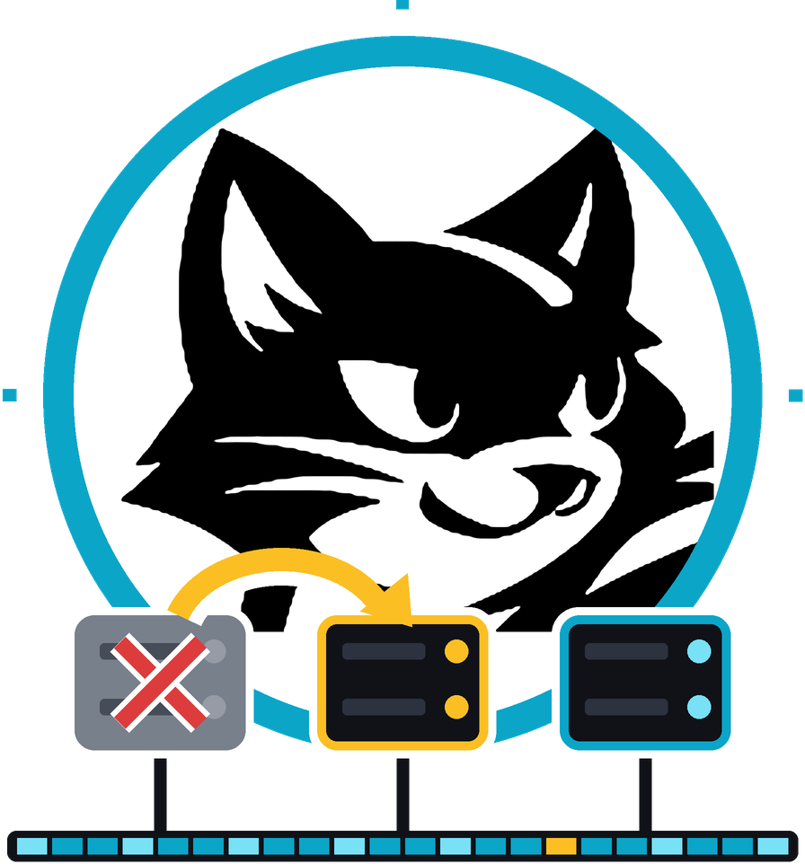

<p align="center"></p>

# felixd

A node agent that runs programs across a cluster with
[Felix](https://github.com/GetFelix/felix) as its only backend.

> **Status:** milestone 3 done. Agents hold a lease per workload, spread
> workloads across nodes, and take a dead node's workloads over within one
> lease TTL. A new owner fences the output stream with a claim record, so a
> node frozen past its lease writes no output when it wakes, and each output
> lands once through lost answers, partial batches and crashes. A three-node
> failover test that keeps killing lease holders runs on every pull request
> and ends with `felixd check`. `felixd replay`
> rebuilds a workload as of any input offset or time, and `--diff` checks a
> replay, or a new module, against the recorded outputs. Workloads implement
> [contract 0.2](docs/contract.md): named and keyed outputs, rejections and
> chunked snapshots. Pipelines, where one workload reads another's output,
> survive failover at every stage; the rest of milestone 4, operations, is
> next. The plan is in
> [docs/design.md](docs/design.md) and the work is tracked in
> [milestones](https://github.com/GetFelix/felixd/milestones).

## Install

Each `v*` release has builds for Linux x86_64, Linux aarch64 and macOS aarch64
(Apple silicon), a `SHA256SUMS` file and its Sigstore signature. Download the
archive for your platform with those two files from the
[releases page](https://github.com/GetFelix/felixd/releases), then check the
signature, which proves the checksums came from this repository's release
workflow, and the archive:

```
cosign verify-blob \
  --bundle SHA256SUMS.sigstore.json \
  --certificate-identity-regexp '^https://github.com/GetFelix/felixd/\.github/workflows/release\.yml@refs/tags/v' \
  --certificate-oidc-issuer https://token.actions.githubusercontent.com \
  SHA256SUMS
sha256sum --ignore-missing --check SHA256SUMS   # shasum -a 256 -c on macOS
tar -xzf felixd-<tag>-<target>.tar.gz
```

The builds are reproducible. The workflow builds each target twice from
different directories and fails unless the archives match byte for byte, with
a locked `Cargo.lock`, the pinned toolchain, `SOURCE_DATE_EPOCH` set to the
commit time and build paths remapped. To check one yourself, check out the
tag and run `scripts/release-build.sh <archive-name> out` with the same
toolchain on the same platform, then compare the archive's hash.

## Try it

You need Rust and a container runtime. The test stack starts one Felix broker
and control plane with development credentials:

```
docker compose -f tests/felix/compose.yaml up -d --wait
tests/felix/credentials.sh /tmp/felix
export FELIX_BROKERS=127.0.0.1:5000 FELIX_AUTH_TENANT=dev \
  FELIX_AUTH_TOKEN_FILE=/tmp/felix/client.jwt FELIX_CA_FILE=/tmp/felix/broker-cert.pem \
  FELIX_CONTROLPLANE_URL=http://127.0.0.1:8443 \
  FELIX_CONTROLPLANE_TOKEN_FILE=/tmp/felix/controlplane.jwt
```

Run the restart test, which submits the example workloads, kills the agent
mid-stream, restarts it and checks the output stream:

```
FELIXD_REQUIRE_FELIX=1 cargo test -p felixd --test restart -- --test-threads=1
```

The failover test runs three agents and six workloads under a steady
producer, kills the live node holding the most leases every 3 s and starts
it again, every other time with a fault that also crashes it between an
append and its answer, then checks every output stream. `FELIXD_FAILOVER_SECS` sets how long
it runs (30 by default; a nightly CI job runs it for 10 minutes):

```
FELIXD_REQUIRE_FELIX=1 cargo test -p felixd --test failover -- --test-threads=1
```

By hand, with a workload component and a durable input stream that already exists. Build a
component from an example workload, then submit it:

```
cargo install wasm-tools
cargo build --manifest-path workloads/Cargo.toml --release --target wasm32-unknown-unknown --package counter
wasm-tools component new workloads/target/wasm32-unknown-unknown/release/counter.wasm -o counter.wasm
```

```
felixd run --id counter --input in --replication-factor 1 counter.wasm
felixd agent
```

`felixd run` stores the module in the `modules` cache, creates the `wl.<id>.out` and
`wl.<id>.snap` streams (and `wl.<id>.merge` when `--input` is given more
than once), appends the spec as a record to the `sys.specs` stream and points the `workloads` cache at it. `sys.specs` keeps every version of every
spec. It creates felixd's caches and
streams with three `Quorum` replicas unless `--replication-factor` says
otherwise; the single-broker test stack needs 1. The agent watches the
`workloads` cache, checks each spec against its record, claims the lease of each
one nobody holds and runs it while the lease holds. Start a second agent and kill the first: within one lease TTL
(10 s by default and at least 2 s, `--lease-ttl-ms`) the second carries on from the right input,
with nothing missing and nothing repeated. Each agent needs its own
`--node-id`; the default is the host name and process id. An agent holds at
most `--max-workloads` (default 64) and waits a random time of up to
`--claim-delay-ms` (default 1000) before claiming a free workload, so that the
first agent to see it does not take everything. Each agent also writes itself
to the `nodes` cache, with the same TTL as its leases.
The connection settings are the environment variables `felixctl` reads, plus
`FELIX_NAMESPACE` (default `default`).
`felixd check` replays each workload's module over its input and compares
the result with its output stream. It reports gaps, duplicates, records out of
order, epoch regressions, outputs that differ from the replay and snapshots
whose output tail does not match their input offset, and exits with 1 if it
finds any. `--id` limits it to one workload; `--complete` also
reports outputs missing from the end of a stream, for when the workloads
should have caught up. `--upstream` also checks the workloads a checked one
reads from, up the pipeline. It writes nothing.

A workload can read another's output stream. This pipeline counts the inputs
on `in`, then counts the first stage's outputs:

```
felixd run --id first --input in --replication-factor 1 counter.wasm
felixd run --id second --input wl.first.out --replication-factor 1 counter.wasm
felixd check --id second --upstream --complete
```

A downstream gets only the records its upstream addresses to `out`, with
their keys. Claims, failures, rejections and other names are passed over, so
a stage can fail over, even in the middle of a batch, without the next stage
seeing anything but the same outputs in the same order.

`felixd replay --id counter --to 41` rebuilds the workload's state after
input 41, and `--to 2026-10-29T14:02:00Z` its state after every input appended
before that time. For a workload with several inputs both count on its merge
log: an offset is a merge log offset, and a time covers the records merged
before it, which is not when they were appended to their own inputs. It
restores the nearest snapshot at or before that point on a fresh instance, runs the inputs after it and prints what the workload's
`inspect` returns. `--diff` replays a range (`--from`, `--to`, by default every
input with a recorded output) and compares each output with the one on the
stream, reporting the first divergence with the node, epoch, input offset and
both digests, and exits with 1 if it finds one. `--module <hash>` runs another
module from the `modules` cache over the recorded inputs instead, so
`--diff --module` checks an upgrade before it goes live. Replay writes nothing,
but until Felix can report a stream's tail to a reader
([Felix #1621](https://github.com/GetFelix/felix/issues/1621)) it needs publish
grants on the streams it reads, as `felixd check` does.
`felixd run --snapshot-every 1000 --snapshot-every-ms 60000` snapshots a
workload every 1000 inputs and at the first input of each minute, by the
inputs' append times on the broker, whichever comes first, so a slow input
still gets snapshots and every node takes them at the same inputs. With
`--keep-snapshots 3` the holder records, after each snapshot, what history
before the oldest of the last three no resume, replay or check needs (a trim
record on the output stream). Nothing is deleted until Felix can trim a stream
at an offset ([Felix #1662](https://github.com/GetFelix/felix/issues/1662)).
A workload is a Wasm component of [workload contract 0.2](docs/contract.md)
(`wit/workload.wit`). Each step gets the input's stream, offset, append time,
key and payload, and returns outputs, each with a name and an optional key, or
rejects the input. A rejection is recorded on the output stream and the
workload carries on. Snapshots are written in chunks, and a chunk the last
snapshot already holds is not written again. `felixd run` refuses a component
built against contract 0.1, and an agent that finds one in a spec leaves it
to an operator rather than failing it.
`felixd run --fuel --max-memory --snapshot-fuel` sets the workload's limits:
fuel per step, memory, and fuel for a whole snapshot or restore. A snapshot that
runs out of fuel is skipped and the workload resumes from the previous one; a restore that
runs out is left to an operator, who can raise the limit. They are stored in
its spec, so every node runs it under the same ones. Running `felixd run`
again for the same id restarts the workload under the new spec, but a new
module or input is refused once the workload has written anything; use a new
id for new code. `felixd run` refuses it, and so does the agent when the output
stream's first claim names a spec, which claims written before spec records
don't. Each claim names the spec it runs, so `felixd check` and
`felixd replay --diff` judge each output under the module and limits it ran with. A workload that traps, runs
out of fuel, returns `poison`, breaks the contract (an invalid output name, an
effect request, a chunk over 4 MiB) or finds its streams in a state it can't resume from is marked
`failed` in its spec, with the reason. The failure is first a record on its
output stream, fenced by epoch like an output, so a node that was frozen
while another took over can't fail it. Its class says whether it is poison or
needs an operator.

What no node can get past without an operator, such as a module that is
still missing after 30 seconds, a 0.1 module or a restore out of fuel, is
not a failure: the spec stays `running`, and the node writes one
needs-operator record with the reason to the output stream, fenced the same
way. Every node then leaves the workload alone until its spec changes or it
is removed. Cache values and stream records carry a format version, so an
older felixd refuses a newer record instead of misreading it. For a workload
that reads another workload's output stream, refusing means it needs an
operator: an older felixd stops there once a record kind it does not know
lands on the stream it reads. Upgrade every node first.

## Try it on three nodes

`deploy/compose.yaml` starts three Felix brokers, a control plane and three
felixd nodes in containers, with development credentials. It works with
`docker compose` and with `podman compose` (use the docker-compose provider,
`PODMAN_COMPOSE_PROVIDER=docker-compose`). You do not need Rust.

```
docker compose -f deploy/compose.yaml up -d --build
docker compose -f deploy/compose.yaml run --rm felixd run --id counter \
  --input in --replication-factor 3 /usr/local/share/felixd/counter.wasm
docker compose -f deploy/compose.yaml --profile producer up -d producer
```

The first build compiles felixd and the example workloads, which takes a few
minutes. `counter` counts the records the producer publishes to `in`. Find
the node that holds it, kill that node and watch another claim it:

```
docker compose -f deploy/compose.yaml logs felixd-1 felixd-2 felixd-3 | grep claimed
docker kill felixd-node-1
docker compose -f deploy/compose.yaml logs -f felixd-2 felixd-3
```

Stop the producer, then check the output stream. Run `felixd check` as often
as you like; it writes nothing:

```
docker compose -f deploy/compose.yaml stop producer
docker compose -f deploy/compose.yaml run --rm felixd check --complete
docker compose -f deploy/compose.yaml down -v
```

`window.wasm` is in the same directory. `FELIX_VERSION` picks the Felix image
tag. The compose file publishes no ports, so the CLI runs in the stack.
`scripts/compose-failover.sh` runs this sequence and CI runs it on every
pull request, under Docker and under rootless Podman.

With Podman, install the docker-compose provider and start the Podman API
socket, then run the same commands with `podman` in place of `docker` (use
`podman kill` for the failover step):

```
systemctl --user enable --now podman.socket
export DOCKER_HOST=unix://$XDG_RUNTIME_DIR/podman/podman.sock
export PODMAN_COMPOSE_PROVIDER=docker-compose
ENGINE=podman scripts/compose-failover.sh
```

## What we are trying to achieve

The long-term goal is a distributed operating system built on one idea:
every change to the system is a durable, ordered record in a log. That covers
what should run, where it runs, what each program received and what it
produced. If the log is the system's memory, a program's state at any moment
can be rebuilt from it. That one property gives you:

- **Failover without lost or repeated work.** When a machine dies, its programs
  continue on another machine from the last record they handled.
- **Migration.** Moving a program is the same operation as failover, done on
  purpose.
- **Time travel.** You can rebuild any program as it was at any past moment,
  inspect it, and step forward record by record.
- **An audit trail.** Every decision the system made is on the record, in
  order.

Today's cluster managers keep a snapshot of current state, so they can
restart programs but can't do any of the above. Felix already provides the
log, replication, conditional writes and per-client resume that the idea
needs. felixd is the first, deliberately small step: a node agent that proves
the idea on real machines.

## Prior work

None of the pieces are new. felixd puts known ideas together in one place.

| Project | What it does | How felixd differs |
|---|---|---|
| [Plan 9](https://9p.io/plan9/), [Sprite](https://www2.eecs.berkeley.edu/Research/Projects/CS/sprite/sprite.html), [Amoeba](https://en.wikipedia.org/wiki/Amoeba_(operating_system)) | Research distributed operating systems: one namespace across machines, and process migration in Sprite | They share live state between machines. felixd rebuilds state from a log, so migration and recovery are the same operation. |
| [Borg](https://research.google/pubs/large-scale-cluster-management-at-google-with-borg/), [Kubernetes](https://kubernetes.io/), [Nomad](https://www.nomadproject.io/) | Cluster managers that keep desired and observed state in a consistent store (etcd, Raft) | They restart a program after a failure and its in-memory state is lost. felixd resumes it from its last input, and keeps history to replay. |
| [Temporal](https://temporal.io/), [Azure Durable Functions](https://learn.microsoft.com/azure/azure-functions/durable/durable-functions-overview) | Durable execution: deterministic workflow code replayed from an event history | This is the closest idea. Determinism there is a coding rule enforced by the SDK, and the history lives in a database behind a service. In felixd the Wasm sandbox enforces determinism, and workloads read any Felix stream. |
| [Golem](https://www.golem.cloud/) | Durable Wasm workers that replay an operation log after a failure | Also close: Wasm plus replay. Golem is a full platform with its own storage. felixd uses only Felix, and a workload's inputs and outputs are ordinary streams that other programs can read. |
| [wasmCloud](https://wasmcloud.com/) | Wasm components spread across hosts over a NATS lattice | Hosts talk over NATS, and a component's state is not rebuilt from a log after a failure. felixd records every input, so it can be. |
| [Flink](https://flink.apache.org/), [Kafka Streams](https://kafka.apache.org/documentation/streams/) | Stream processing with checkpoints and exactly-once output | These are dataflow frameworks with a coordinator and checkpoint storage beside Kafka. felixd runs general programs, and the log is the only coordinator. |
| [Corfu and Tango](https://www.microsoft.com/en-us/research/publication/tango-distributed-data-structures-over-a-shared-log/), [Delos](https://www.usenix.org/conference/osdi20/presentation/balakrishnan) | Distributed systems built on a shared log as the source of truth | The same foundation, applied to data structures and metadata stores. felixd applies it to running programs. |

## Why build it

- **One substrate.** Each project above needs its own coordinator or database
  next to the log. We want to find out whether a single replicated log, with
  conditional writes and leases, is enough to run programs on: no etcd, no
  workflow database, no job manager.
- **Determinism enforced by the platform.** A Wasm component with no clock,
  randomness or I/O can't break replay by accident. That moves determinism
  from a coding rule you must remember to something the runtime guarantees.
- **History you can query.** Every input, output and ownership change is a
  stream that ordinary Felix clients can read. Debugging a past incident
  means replaying it, not reconstructing it from logs.
- **A demanding user for Felix.** felixd depends on Felix's ordering, fencing
  and resume guarantees under node failure. Anything that falls short shows
  up as a `felix-gap` issue against Felix.

## The first step

felixd runs on every node. It runs WebAssembly programs ("workloads") whose
only inputs and outputs are Felix streams. The first version has to show
three things:

1. **Kill a node mid-run.** Each of its workloads resumes on another node, and
   its output has no gaps and no duplicates.
2. **Freeze a node and let it come back late.** The stale copy of a workload
   cannot write anything once another node has taken over. The new owner's
   first write is a claim record on the output stream, so the stale copy's
   next append is refused even if the new owner never writes an output.
3. **Replay a workload to any past offset or time** and inspect its state.

Scheduling policy, resource limits, networking and native processes come
after that works. [docs/design.md](docs/design.md) explains the path from
here to an operating system.

## Scenarios and use cases

felixd fits work that keeps state, reacts to a stream of events, and must not
lose or repeat results when a machine fails. These are the cases we are
designing for. Failover, exactly-once output, replay and pipelines work today; operations
are still planned.

- **Stateful stream processing without a separate cluster.** Running totals,
  sessions, fraud scores over a window, deduplication. Today that usually
  means Flink or Kafka Streams with checkpoint storage beside the broker. With
  felixd it is a small Wasm workload on Felix, and a node loss doesn't
  double-count or drop anything.
- **State machines where history matters.** An order book, inventory,
  billing or a ledger, where you must be able to answer "what did the system
  believe at 14:02, and why?" `felixd replay --to 14:02` rebuilds that state
  from the same inputs.
- **Fleets of unreliable machines.** Edge gateways, factory floors, home labs:
  machines that reboot, lose power or drop off the network. A workload moves
  to a machine that's up and continues from its last input, with no operator
  involved.
- **Authoritative game and simulation servers.** A match or a simulation tick
  loop is a deterministic state machine fed by player inputs. If its server
  dies, the match continues on another one, and any match can be replayed
  afterwards. [felix-arena](https://github.com/GetFelix/felix-arena) and
  [felix-metro](https://github.com/GetFelix/felix-metro) already use logs this
  way inside one process.
- **Reproducing production bugs.** Instead of guessing from logs, replay the
  workload on your laptop to the offset just before the bad output and step
  through it.
- **Checking an upgrade before it goes live.** Run a new version of a module
  against recorded inputs and compare its outputs with what the current
  version produced, before switching it on.

A worked example: a payments team runs a fraud-scoring workload per merchant.
A node dies during a traffic spike. Within one lease TTL, its workloads are
running on the other nodes, every transaction is scored exactly once, and
the late-arriving copy on the recovered node is refused. A week later, a
merchant disputes a decision, and the team replays that merchant's workload
to the moment of the transaction to see exactly what the score was based on.

felixd is not a fit, at least for now, for low-latency request and reply
services, programs that need the network or files directly (that comes with
effects, step 4 in the design), or heavy compute where replaying from a
snapshot would take too long.

## What you will be able to do

- Start felixd on a few machines pointed at one Felix cluster
- Submit a Wasm workload and the stream it reads from
- Kill or freeze any node and watch its workloads move
- Chain workloads, so one's output is the next one's input
- Replay a workload to an offset or a time and print its state

## Felix features it uses

| Need | Felix feature |
|---|---|
| What should run | A cache, watched with retained values |
| Which node runs a workload | A cache entry with a TTL, taken and renewed with `cache_put_if` |
| Which nodes are alive | A cache with a TTL |
| A workload's input | A durable stream, resumed with `subscribe_from` |
| Output that a stale owner cannot write | `publish_if` against the output stream's tail |
| The order several inputs are stepped in | A durable stream per workload, written with `publish_if` like the output |
| Surviving a broker's loss | `Quorum` streams and caches |
| Snapshots | A durable stream per workload |
| Replay to a time | `offset_for_time` and range reads |
| What each node may write | RBAC grants on each node's token |

## How it works


A workload is a Wasm component with no access to clocks, randomness, files or
the network. It sees only the records on its input stream, so given the same
records it always reaches the same state. That determinism is what makes
failover and replay safe.

Each felixd watches the list of workloads and claims unowned ones by writing a
lease with a conditional put. While it holds the lease it feeds the workload
input records, appends its output with a write that only succeeds at the
output stream's current tail, and writes a snapshot every so often. If the
node stops renewing, the lease expires and another felixd claims the workload,
loads the latest snapshot and resumes from the input offset recorded in it.
Each output record carries the input offset that produced it, so the new
owner knows which outputs already exist and does not write them again.
A workload can read several streams. The holder records the order it steps
their records in on a merge log, fenced the same way, and a new owner, replay
and `felixd check` follow that log, so the order is the same everywhere.
[docs/design.md](docs/design.md) has the details.

## Status

| M | Milestone | What it proves | State |
|---|---|---|---|
| 0 | One node, one workload | The workload contract works; a restart resumes where it stopped | Done |
| 1 | Leases and failover | Kill a node and its workloads continue elsewhere | Done |
| 2 | Exactly-once output | A frozen node that comes back cannot write | Done |
| 3 | Replay | Rebuild any workload at any offset or time | Done |
| 4 | Pipelines and operations | Chained workloads, several inputs, drain, status, metrics | Pipelines and several inputs done |
| 5 | Self-hosting | Anyone can run a cluster from the docs | Planned |

## Crates

| Crate | What it is |
|---|---|
| [`crates/core`](crates/core/README.md) | Record formats, names, lease and placement rules and the resume fold. No I/O. |
| [`crates/runtime`](crates/runtime/README.md) | The wasmtime host that runs a workload component under fuel and memory limits. |
| [`crates/agent`](crates/agent/README.md) | The node loop: leases, fencing, resume, output and snapshots. |
| [`crates/felixd`](crates/felixd/README.md) | The `felixd` command line. |
| [`crates/testkit`](crates/testkit/README.md) | Test helpers that build the example workloads. |
| [`workloads`](workloads/README.md) | The example workloads, [`counter`](workloads/counter/README.md) and [`window`](workloads/window/README.md), and the test fixture [`faulty`](workloads/faulty/README.md). |

## Documentation

- [docs/design.md](docs/design.md): goals, design, data model and build order
- [docs/records.md](docs/records.md): record formats and the resume fold
- [Felix docs](https://docs.getfelix.dev/)

## Contributing

The plan is open for discussion. Start with
[what to build first](https://github.com/GetFelix/felixd/discussions/31) and the
[open design questions](https://github.com/GetFelix/felixd/discussions/33), or
browse [all discussions](https://github.com/GetFelix/felixd/discussions).
See [CONTRIBUTING.md](CONTRIBUTING.md) for how changes are made.

## License

MIT. See [LICENSE](LICENSE).
