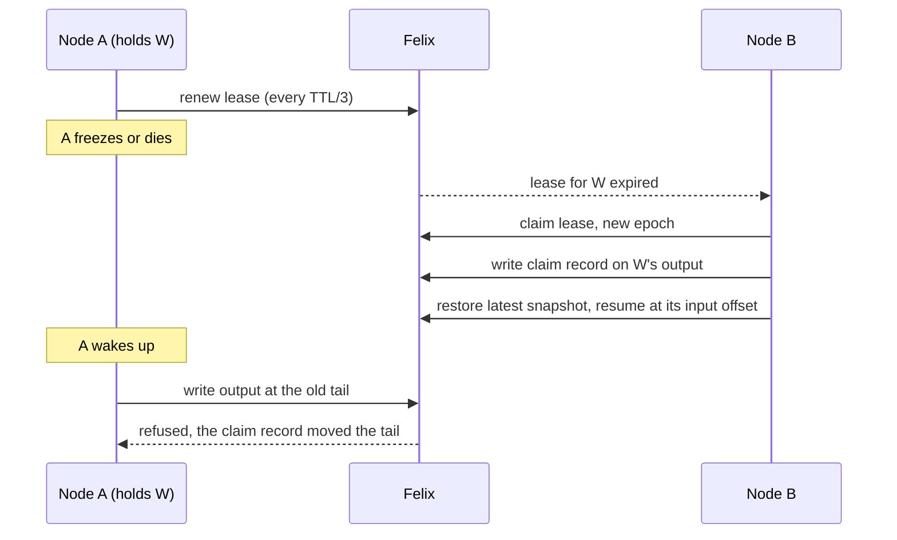

# Operating felixd

How to run felixd for real: what to start, how to configure it, who may do what, how long to
make the lease TTL, what to watch, and what a failover does and does not promise. For how it
works inside, see [design.md](design.md). For a first run on one machine, see the
[README](../README.md#try-it).

## What runs where

felixd runs programs, called workloads, across a cluster. A workload is a WebAssembly module that
reads records from Felix streams and writes records back, and felixd moves it to another node
when its node fails. felixd keeps all of its state in [Felix](https://docs.getfelix.dev/) and
nothing on its own disk that matters, so a node can lose its disk and rejoin. A cluster is:

- **Felix**: brokers and a control plane. Use three brokers and replication factor 3
  (`Quorum`) to survive a broker failure. One broker is fine for trying things out.
- **One `felixd agent` per machine.** Each agent claims workloads, runs them and writes their
  output to Felix. Several agents on one machine are not independent failure domains.
- **The `felixd` command line**, run from anywhere that can reach Felix, to submit workloads
  (`run`), look at the cluster (`ps`, `check`, `replay`) and move work (`drain`, `undrain`).

The agents never talk to each other. They find out about each other, and about the work to be
done, by reading Felix.

## Before you start

- A Felix cluster of the release felixd is built on. `.felix-version` in the repository names it
  (0.7.0-preview.2 at the time of writing), and the container image and the compose files use it.
  The [Felix docs](https://docs.getfelix.dev/) cover installing brokers and a control plane.
- A tenant and a namespace for felixd (`default` unless you set `FELIX_NAMESPACE`). Felix's docs
  also cover creating a tenant and getting tokens for a principal.
- For a three-broker cluster, the Felix features failover needs, finalized once by a Felix
  operator: `generation_start`, `majority_ack`, `lease_free_reads` and `fenced_caches`.
  `deploy/compose.yaml` shows the calls in its `felix-fleet` service.
- A token for each role below, in a file.

## Run a node

Install a release binary ([README](../README.md#install)) or build the container image:

```
docker build -f deploy/felixd.Dockerfile -t localhost/felixd:local .
```

The image holds the `felixd` binary and the example workloads, and runs as user 65532. Start
one agent per machine and give each a unique `--node-id`. Every command needs the connection
settings in [Configuration](#configuration), at least the brokers, the tenant, a token file and the
control plane URL; here they are environment variables:

```
export FELIX_BROKERS=10.0.0.11:5000 FELIX_AUTH_TENANT=acme \
  FELIX_AUTH_TOKEN_FILE=/etc/felixd/node.jwt FELIX_CONTROLPLANE_URL=http://felix-controlplane:8443
felixd agent --node-id node-1 --lease-ttl-ms 10000
```

An agent runs until it is interrupted. On SIGINT (Ctrl-C) it stops its workloads and deletes
its leases, so other nodes take over at once. It does not handle SIGTERM, which a container
runtime ignores for a process running as PID 1 (so `docker stop` waits for its timeout and then
kills it) and which systemd treats as a kill. Either way its leases wait out the TTL. Either
[drain](#upgrade-or-retire-a-node) the node first, or make your supervisor send SIGINT
(`stop_signal: SIGINT` in Compose, `KillSignal=SIGINT` in systemd).

If the agent exits, restart it. A restarted agent does not adopt the leases it held before,
which makes two processes with the same `--node-id` safe; it waits for them to expire.

## Configuration

Every command reads the same connection settings, as flags or environment variables. The brokers,
the tenant, the broker token file and the control plane URL are required by every command, even
those that never call the control plane.

| Variable | Flag | Meaning |
|---|---|---|
| `FELIX_BROKERS` | `--brokers` | Broker addresses, `host:port` or `ip:port`, comma separated. One is enough; the rest are discovered |
| `FELIX_SERVER_NAME` | `--server-name` | The name on the brokers' certificate (`localhost`) |
| `FELIX_AUTH_TENANT` | `--tenant` | The Felix tenant |
| `FELIX_NAMESPACE` | `--namespace` | The namespace for felixd's streams and caches (`default`) |
| `FELIX_AUTH_TOKEN_FILE` | `--token-file` | File holding the broker token |
| `FELIX_CA_FILE` | `--ca-file` | PEM file to trust for the brokers' certificate. The platform roots are used when left out |
| `FELIX_CONTROLPLANE_URL` | `--controlplane-url` | The control plane, such as `http://felix-controlplane:8443` |
| `FELIX_CONTROLPLANE_TOKEN_FILE` | `--controlplane-token-file` | File holding the control plane token. Needed by whatever creates streams and caches: `init`, `drain`, `run` without admission, and the agent that runs admission. `run` through admission, `undrain`, `ps`, `check`, `replay` and other agents do not need it |

Tokens are read from files only, never from arguments or the environment, and are read again each
time they are used. Replace the file in place to rotate a token; an agent keeps its leases. A file
caught empty or half written keeps the previous token. felixd never writes a token to a log.

`RUST_LOG` sets the log level (`felixd=info,felixd_agent=info` by default).

The agent's own flags, all optional:

| Flag | Default | Meaning |
|---|---|---|
| `--node-id` (`FELIXD_NODE_ID`) | host name and process id | This node's name in leases, `ps` and metrics. Must be unique and should be stable |
| `--lease-ttl-ms` | 10000 (at least 2000) | How long a lease lives without renewal. Use the same value on every node. See [sizing](#sizing) |
| `--max-workloads` | 64 | The most workloads this node holds. A full node claims nothing more |
| `--claim-delay-ms` | 1000 | The longest random wait before claiming a free workload, so the first node to see it does not take everything |
| `--stuck-after-ms` | 60000, or the TTL if longer | How long a held workload may keep failing on a transient error, with no progress, before the node records it as degraded and releases it. At least the TTL; 0 turns it off |
| `--degraded-backoff-ms` | 120000 | How long a node leaves a workload alone after releasing it as degraded, so another node gets a turn |
| `--assignment-bound-ms`, `--assignment-grace-ms`, `--facts-every-ms` | 15000, 2000, three TTLs | Only matter while a [scheduler](design.md#placement) runs |
| `--metrics-bind` (`FELIXD_METRICS_BIND`) | off | Serve Prometheus metrics, such as `127.0.0.1:9464` |
| `--metrics-max-workloads` | 100 | Workloads that get their own metric series |
| `--admission-token-file` (`FELIXD_ADMISSION_TOKEN_FILE`) | the node's own token | Broker token of admission's credential, for a node that runs admission |

`felixd <command> --help` lists everything, including the limits `run` stores in a spec.

## Who may do what

Felix decides, with RBAC policies on each token. felixd needs a different set for each job, so use
a different principal for each. The node, admission and submitter roles are broker tokens
(`--token-file`). The operator rights are the control plane token (`--controlplane-token-file`).

| Principal | Used by | May |
|---|---|---|
| Node | `felixd agent` | Read every stream and cache of the namespace and its system namespace; publish to workload streams and `sys.facts`; write `leases`, `epochs`, `nodes` and `workloads` |
| Admission | the one node that runs admission, with `--admission-token-file` and a control plane token | The only role that writes `sys.specs`; creates the streams of accepted workloads |
| Submitter | `felixd run` through admission | Put modules, publish requests on `sys.intake`, read decisions and specs |
| Viewer | `felixd ps`, `check`, `replay` | Read everything. `check` and `replay` also probe a stream's tail with a conditional publish, so they need publish on the streams they read |
| Operator | `felixd init`, `drain`, `run` without admission | Create namespaces, streams and caches. `init` also needs `rbac.view` over the whole tenant and `rbac.policy.manage`. `run` without admission also writes `workloads`, `sys.specs` and `modules`. `drain` and `undrain` write the `drains` cache |

[design.md](design.md#grants) has the exact rules. To set them up:

Admission is itself a felixd workload that decides which submissions run. Set it up before you
submit anything:

1. Get `admission.wasm`. The container image has it at `/usr/local/share/felixd/admission.wasm`
   (`docker create` the image and `docker cp` it out); a release binary does not include it, so
   build it from `workloads/admission` as the Dockerfile does.
2. Run `felixd init admission.wasm` once per namespace, as an operator. It creates the namespace
   and its system namespace (`<namespace>.sys`, where `sys.specs`, `sys.intake` and `sys.facts`
   live, out of reach of a node's grant on the workload streams), writes the policies of three
   roles, `role:felixd.<namespace>.node`, `.admission` and `.submitter`, and writes admission's
   spec. Running it again changes nothing.
3. Assign each principal to its role with `felixctl`, using a control plane token with
   `rbac.policy.manage`. Every principal gets one role; the admission principal must not also be a
   node:

   ```
   felixctl rbac grouping add p:node-1 role:felixd.default.node
   felixctl rbac grouping add p:admission role:felixd.default.admission
   felixctl rbac grouping add p:ci role:felixd.default.submitter
   ```

4. Start one agent with admission's credential, so a node runs the admission workload:

   ```
   felixd agent --node-id node-1 --admission-token-file /etc/felixd/admission.jwt \
     --controlplane-token-file /etc/felixd/controlplane.jwt
   ```

From then on `felixd run` goes through admission, and nodes run only what it accepted. A workload
submitted directly before `init` stops running after it, because nodes now want an accepting
decision, so run `init` first or submit it again. Without admission, an operator submits
directly with a control plane token and `felixd run`.

Today a node can write any workload's output stream. The fence keeps the output correct, but a
compromised node could write garbage. Per-lease tokens, which narrow a node to the workloads it
holds, wait on Felix ([#74](https://github.com/GetFelix/felixd/issues/74)).

## Sizing

**Lease TTL.** A node renews every TTL/3 and stops its workloads two thirds of a TTL after its
last successful renewal, before anyone else can claim. When a node dies, its workloads resume
elsewhere in about one TTL, plus up to `--claim-delay-ms` and the replay since the last snapshot. So:

- A shorter TTL means faster failover and more renewal traffic. A renewal is a write to Felix
  per workload, three times per TTL.
- A TTL that is too short for your broker's worst pause makes healthy nodes lose leases. Watch
  `felixd_lease_handoffs_total{reason="lost"}`; it should stay at 0. A drain shows as
  `reason="drained"`.
- Set the same value on every node. The compose files use 4000 for quick demonstrations. The
  default of 10000 is a safer start.

**Workloads per node.** `--max-workloads` caps one node. Fewer, larger nodes give less spare
capacity when one fails: the survivors must have room for its workloads, or they stay
`waiting`. Keep the sum of the survivors' caps above the total.

**Cluster size.** The scale test measures how many workloads a cluster carries; see
[Scale](design.md#scale).

**Replication.** Use `--replication-factor 3` on `run` and `init` against three brokers. The
default is 3; 1 is for a single broker.

**Snapshots.** `run --snapshot-every` (1000 inputs by default) and `--snapshot-every-ms` bound
how much a new owner replays after a failover. `--keep-snapshots K` lets the history before the
oldest of K snapshots be trimmed.

**Modules.** A module can be up to 64 MiB; one over 8 MiB is stored in chunks
([design.md](design.md#modules)).

## What failover and replay guarantee

When a node dies or is drained, another claims its workloads and carries on:



What you can rely on:

- **Each workload runs on one node at a time, as far as output goes.** Two nodes may briefly both
  believe they hold a workload, for example after a long pause. Only the one at the output's
  current tail can write; the other's write is refused and it stops. The lease decides who
  should run, and the fence decides what is written.
- **Each input produces its outputs once.** Not lost and not repeated, through lost answers,
  partial batches, crashes and takeovers. `felixd check` verifies it from the log.
- **Takeover resumes from a snapshot**, not from the start, and costs the inputs since the last
  snapshot.
- **Replay is exact.** A workload is deterministic, so `felixd replay` rebuilds its state at any
  input offset or time, and `felixd replay --diff` compares a replay, or a new module, with what
  was recorded.

What it does not promise:

- **No guarantee about timing.** Failover takes about one TTL. Input published meanwhile waits in
  the log and is processed afterwards.
- **A live subscriber can miss records.** Felix may drop records for a slow live subscriber. Read a
  workload's output by offset from its stream, or run `felixd check`, instead of trusting a live
  subscription.
- **Lease exclusivity rests on the broker's clock.** A broker whose clock jumps forward can
  expire leases early. That costs duplicate work and refused writes, never wrong output.
- **No protection from a hostile node** until per-lease tokens exist (see above).

## Try a failover on three nodes

The [README](../README.md#try-it-on-three-nodes) walks through `deploy/compose.yaml`, which starts
three Felix brokers, a control plane and three felixd nodes with development credentials, under
Docker or Podman. Run it once before you build a real cluster. It does these things, in order,
and each is something you will do in production too:

1. Starts three nodes with a 4 s lease TTL, so a failover shows within seconds.
2. Submits the `counter` workload and a producer that feeds it ten records a second.
3. Reads `felixd ps` to find the node that holds `counter`, then kills that node's container
   (`docker kill` or `podman kill felixd-<node id>`). `ps` then shows another holder with a higher
   epoch.
4. Drains a node (`felixd drain node-2 --wait`) to move its workloads without a failure, then
   undrains it.
5. Stops the producer and runs `felixd check --complete`. It writes nothing, and `--complete` also
   reports outputs missing from the end of the stream, which is what you want once the workload has
   caught up.

`scripts/compose-failover.sh` runs the kill and the check, and CI runs it on every pull request
under Docker and under rootless Podman.

## Watching a cluster

- **`felixd ps`** is the view from the log, and the same from any machine. It shows each
  workload's state (`running`, `claiming`, `waiting` for a holder, `needs-operator`, `degraded`,
  `failed`, `stopped`), its holder and epoch, how far behind each input it is, and each node's state.
- **Metrics.** Start agents with `--metrics-bind` and scrape each one. [metrics.md](metrics.md)
  lists every metric and the questions they answer. The endpoint is plain HTTP without
  authentication and names workloads and streams, so keep it on an internal network. `/live`
  answers `ok` for a probe.
- **`felixd check`** replays every workload over its input and compares the result with its
  output stream. Run it on a schedule. It exits 1 on anything it finds.

## When a workload needs you

| `ps` shows | Meaning | What to do |
|---|---|---|
| `waiting` | No node holds it | If no agent is up, start one. If every node is draining or full, undrain a node or raise `--max-workloads`. Otherwise give it a few seconds |
| `needs-operator` with a reason | Something no node can get past: a missing module, a module built for contract 0.1, a restore out of fuel | Fix the cause. For a limit, such as a restore out of fuel, raise it and run `felixd run` again for the same id; a new spec record clears it. A new module or input is refused once the workload has written anything, so a module built for contract 0.1 needs a new id |
| `degraded` | A node kept failing on a transient error, such as an unreachable Felix, and released the workload so another node can try | Check the node's log and Felix. Nothing else to do if another node has taken it. If it keeps coming back on every node, the cause is the workload's streams or module, not a node: look with `felixd check --id`. Draining only moves the problem |
| `failed` with a reason | A trap, out of fuel, `poison`, or a contract break. The workload is stopped | Read the reason. Submit a fixed module under a new id |
| `failed` with a divergence line under the table | A node replayed the inputs and got an output other than the one on the stream | The line names the input, the node, the build and both digests. Find out whether the module, the inputs or the build changed; `felixd replay --diff` reproduces it |

Stop a workload by deleting its entry in the `workloads` cache:

```
felixctl cache del workloads counter
```

This needs a broker token with write on the `workloads` cache, such as an operator's. Its streams stay. felixd has no stop command yet ([#101](https://github.com/GetFelix/felixd/issues/101)).

## Upgrade or retire a node

Drain first. `felixd drain node-1 --wait` makes the node release each workload so others carry
on at once, and returns when it holds nothing. It exits 1 after `--timeout-secs` (300), which is also what happens for a node of an older build, since it never acknowledges the mark. Then stop it,
replace the binary, start it and `felixd undrain node-1`. Do the nodes one at a time, and let
`ps` show every workload running before you move to the next.

From this build on, a node that meets a record from a newer build leaves that workload alone and never fails it.
Upgrade every node before you rely on a feature of the new build.

A build from before the degraded record cannot read it and fails the workload as poison, so
while any such node is left, start the new agents with `--stuck-after-ms 0`. The new nodes then
retry a stuck workload for ever and write no record. Restart them without it once every node is
new.
